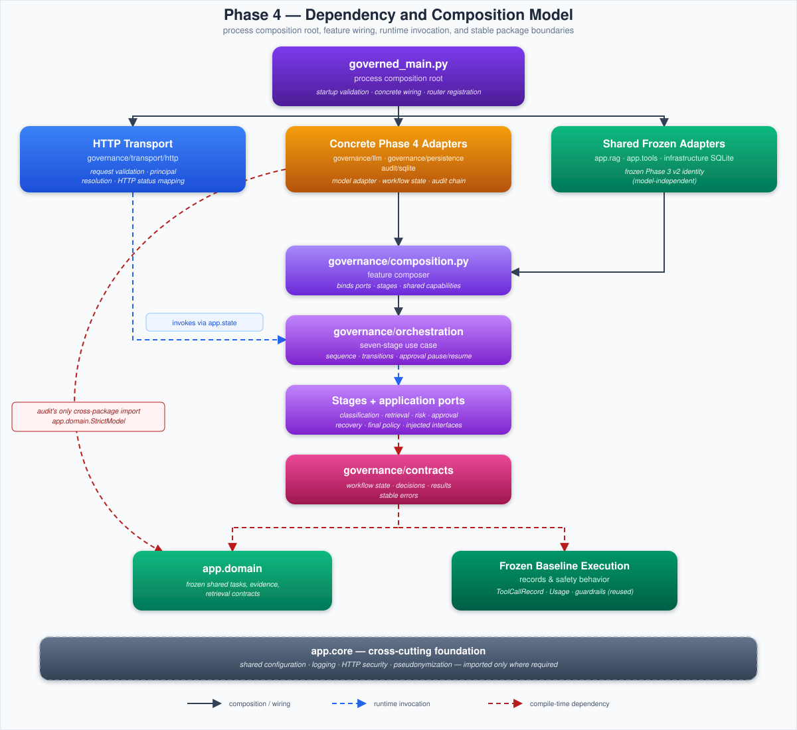

# Phase 4 governance architecture

## Purpose and declared scope

Phase 4 is the governed treatment layered outside the frozen `phase3-baseline-v2` control. It
evaluates whether an explicit workflow improves reliability, safety, traceability, and groundedness
while both conditions retain the same knowledge corpus, retrieval configuration, synthetic business
state, model family, and simulated capability set.

The design is clean architecture with feature-owned adapters and domain-oriented contracts; its
architecture-description terminology is informed by [1]. It is not a distributed workflow
platform, identity provider, production authorization service, or enterprise records-management
system. The detailed runtime and verification contract is maintained in
[Phase 4 governed treatment](../phase-4-governance.md); the frozen comparison boundary is defined by
[Phase 3 baseline](../phase-3-baseline.md).

## Dependency and composition model




The diagram distinguishes composition and wiring, runtime invocation, and compile-time package
dependencies. `governance/composition.py` is a bounded feature composer below the process-level
composition root; it does not own FastAPI lifecycle or transport registration.

`app.governance` is a vertical feature package rather than one clean-architecture layer. Contracts,
orchestration, stages, provider ports, SQLite adapters, security policy, and HTTP transport remain
separate internal packages. `governed_main.py` is the sole process composition root and selects
concrete adapters.

The entire shared `app.infrastructure` tree belongs to the Phase 3 v2 cryptographic identity.
Phase 4 therefore consumes its frozen model-independent SQLite adapter but keeps treatment-specific
workflow and audit adapters under `governance/persistence` and `audit/sqlite`. Moving them into the
shared infrastructure tree would invalidate the control condition.

## Component ownership

| Component | Owns | Does not own |
|---|---|---|
| `governance/contracts` | Workflow state, decisions, results, stable errors | HTTP, SQLite, provider payloads |
| `governance/stages` | Classification, retrieval, proposal, risk, approval, recovery, final-response policy | Workflow persistence or HTTP routing |
| `governance/orchestration` | Stage sequence, state transitions, approval resume, failure closure | Concrete adapter construction |
| `governance/llm` | Governance model port, OpenAI adapter, prompts, provider payload mapping | Risk or approval decisions |
| `governance/persistence` | Workflow repository port, optimistic SQLite state, approvals, unit of work | Risk policy or audit vocabulary |
| `governance/security` | Configured principal roles, pseudonyms, proposal digests, audit-key resolution | HTTP authentication middleware |
| `audit` | Independent event vocabulary, repository port, keyed hash chain, SQLite adapter | Workflow policy or approval authorization |
| `governance/transport` | Request validation, authenticated principal resolution, HTTP status mapping | Business decisions or database construction |
| `app.domain`, `app.rag`, `app.tools`, `app.infrastructure` | Frozen shared tasks, evidence, retrieval, tools, and synthetic state | Phase 4 policy or workflow state |
| `governed_main.py` | Startup validation, concrete wiring, application state, router registration | Stage behavior |

Governance contracts reuse the frozen baseline `ToolCallRecord` and `Usage` models because the two
conditions must report the same execution and token-accounting vocabulary. This is an explicit
experimental dependency, not a claim that those models are shared domain concepts.

## Startup sequence

1. `create_governed_app` resolves shared and governance-security settings, overrides the governed
   service identity, validates production or experiment requirements, and configures logging.
2. FastAPI registers security middleware, trusted hosts, the frozen health router, and governed
   workflow routes. OpenAPI and interactive documentation are disabled in production.
3. The application lifespan constructs `KnowledgeRetriever`, validates the corpus, initializes the
   frozen synthetic SQLite repository, and seeds the default case only when absent.
4. The lifespan initializes the workflow and audit schemas in the same configured SQLite database.
   The audit adapter receives the dedicated integrity key in experiment and production profiles.
5. When an OpenAI credential exists, the composition root builds the governance model, frozen tool
   registry and router, seven stage services, injected ports, and `GovernedWorkflow`.
6. Experiment startup verifies the complete Phase 3 control identity and records the governed
   experiment manifest. Verification or manifest failure aborts startup.
7. The lifespan exposes readiness, repositories, workflow, and optional manifest through application
   state. Without a configured model, liveness succeeds while readiness remains unavailable.

## Invocation and approval sequence

```text
authenticated request
  -> resolve request ID: replay identical input | reject changed input with HTTP 409
  -> create durable workflow + workflow-started audit event atomically
  -> classify
  -> retrieve approved evidence
  -> generate one proposed response or allowlisted action
  -> apply deterministic risk policy
  -> route: continue | deny | clarify | require human approval
       require approval
         -> persist role-bound pending records + audit events atomically
         -> authenticated configured principal submits one decision
         -> validate role, proposal digest, expiry, and state version
         -> persist decision + audit event atomically
         -> resume only after every required role approves
  -> execute bounded idempotent simulated attempts when authorized
  -> guard and persist final response
  -> append terminal audit events atomically
```

Caller input never establishes approval identity. The request supplies only the target role,
decision, proposal digest, expected state version, and optional comment. The principal and allowed
roles come from server configuration after API-key authentication.

Each model, retrieval, or tool operation runs outside a database transaction. Stage-start events are
committed before external work. A successful state checkpoint and its completion event share one
short SQLite transaction. Approval state and its mandatory audit event also commit or roll back
together.

## Failure and consistency model

| Condition | Enforced behavior |
|---|---|
| Missing production API key, roles, or audit key | Configuration fails before serving traffic |
| Model absent | Liveness remains available; readiness and invocation are unavailable |
| Invalid request or caller-claimed identity | HTTP validation rejects the request before workflow execution |
| Unknown synthetic case | Workflow creation fails with a stable external error |
| Repeated request ID with identical input | Existing workflow is returned without repeating model or tool work |
| Repeated request ID with changed input | Request is rejected with HTTP 409 Conflict |
| Stage exception | Current state fails closed with stable attribution and secret-safe audit details |
| Stale approval command | Optimistic state-version check rejects the decision |
| Wrong role, digest, or expired approval | Decision is rejected without action execution |
| Audit write failure during a required state transition | Shared unit of work rolls back the transition |
| Retryable simulated failure | Recovery performs no more than the configured bounded attempts |
| Non-retryable or exhausted failure | Workflow terminates safely without a success claim |
| Unsafe or invalid final model output | Guarded failure response is persisted and audited |

State-changing tools require idempotency keys, and the synthetic persistence adapter enforces their
reuse. If execution succeeds but a later checkpoint fails, retrying the simulated tool returns the
prior result rather than repeating the effect. This protects the pilot's local state; it is not a
distributed exactly-once guarantee.

## Security and data trust boundaries

The secure-development posture is informed by [2] and the agent-specific threats catalogued in [3].
These are engineering references, not certification claims.

| Data or actor | Trust classification | Enforcement boundary |
|---|---|---|
| HTTP headers and body | Untrusted | Trusted hosts, API-key middleware, strict Pydantic contracts |
| Caller identity claims | Untrusted | Contracts exclude principal identity; server configuration supplies subject and roles |
| Query, retrieved text, and tool output | Content-untrusted | Prompt separation, evidence identity, strict stage contracts, final guardrail |
| Model classification, proposal, and final output | Untrusted | Structured schemas, allowlisted tool catalog, deterministic risk and approval policy |
| Tool arguments | Untrusted | JSON parsing, selected Pydantic schema, trusted execution context, frozen router |
| Approval command | Untrusted decision data | Role binding, proposal digest, expiry, optimistic version, durable approval record |
| Audit actor identifier | Sensitive application data | Keyed pseudonym before persistence |
| Audit content | Sensitive application data | Minimal metadata plus keyed input/output digests in controlled profiles |
| SQLite workflow and audit state | Trusted local pilot state | Foreign keys, explicit transactions, optimistic versions, append-only audit triggers |
| API, OpenAI, safety, and audit secrets | Secret configuration | `SecretStr`, production validation, redacting logs, no response exposure |

Tools remain allowlisted, schema-validated, bounded, and simulated. OpenAI tool definitions and
structured outputs follow the strict boundary principles described in [4]. FastAPI lifespan owns
runtime adapter initialization as described in [5].

## Audit guarantees and limits

Each event commits its schema version, event/workflow/trace identities, sequence, stage, actor,
timestamp, input/output digests, details, and previous hash into an HMAC-SHA-256 chain. SQLite
triggers reject normal updates and deletes. Verification rejects empty traces, sequence gaps,
identity changes, wrong keys, modified fields, and broken links.

The chain is tamper-evident application storage, not independently witnessed evidence. A database
administrator with access to both storage and the integrity key can replace the chain. Stronger
non-repudiation requires signed checkpoints exported to an external append-only or WORM system.

## Known architectural compromises

1. Governance reuses frozen baseline execution records, guardrails, and `ToolRouter`. This preserves
   experimental equivalence but creates a deliberate governance-to-baseline dependency.
2. Phase 4 concrete SQLite and OpenAI adapters remain within the governance and audit feature
   packages because `app.infrastructure` is frozen. Their internal ports still enforce dependency
   inversion, but package placement is less uniform than a greenfield design.
3. One API key represents one configured approval principal. Federated identities and per-user
   tokens require a replacement authentication adapter.
4. SQLite provides local durability and serialization only. Multi-instance execution needs a
   database and unit-of-work adapter with equivalent optimistic and transactional behavior.
5. Model and tool calls are synchronous. A durable worker queue is unnecessary for this pilot's
   evaluation volume but would be required for long-running or horizontally scaled workflows.
6. The Phase 3 verifier hashes worktree bytes. Line-ending conversion can therefore cause a Windows
   verification mismatch even when Git's normalized content is unchanged.

These compromises are explicit so the pilot remains readable and testable without overstating its
security or operational maturity.

## Architecture verification expectations

`tests/governance/architecture/test_boundaries.py` must fail when:

- a declared audit, governance, persistence, transport, or process-entry component is missing;
- audit imports the governance implementation and creates a dependency cycle;
- governance contracts import orchestration, stage, transport, provider, or persistence adapters;
- orchestration or stages import concrete OpenAI, SQLite, or HTTP adapters;
- HTTP transport constructs or imports concrete outbound adapters.

These static tests protect dependency direction. They do not replace runtime integration tests,
threat modeling, code review, provider smoke testing, or evaluation of the four research outcomes.

## References

[1] *Software, Systems and Enterprise—Architecture Description*, ISO/IEC/IEEE Standard
42010:2022, Nov. 2022. [Online]. Available: https://www.iso.org/standard/74393.html.
[Accessed: Jul. 24, 2026].

[2] M. Souppaya, K. Scarfone, and D. Dodson, *Secure Software Development Framework (SSDF)
Version 1.1: Recommendations for Mitigating the Risk of Software Vulnerabilities*, NIST Special
Publication 800-218, Feb. 2022, doi: 10.6028/NIST.SP.800-218.

[3] OWASP Foundation, “AI Agent Security Cheat Sheet,” *OWASP Cheat Sheet Series*. [Online].
Available: https://cheatsheetseries.owasp.org/cheatsheets/AI_Agent_Security_Cheat_Sheet.html.
[Accessed: Jul. 28, 2026].

[4] OpenAI, “Function calling,” *OpenAI API Documentation*. [Online]. Available:
https://developers.openai.com/api/docs/guides/function-calling. [Accessed: Aug. Jul 30, 2026].

[5] S. Ramírez, “Lifespan Events,” *FastAPI Documentation*. [Online]. Available:
https://fastapi.tiangolo.com/advanced/events/. [Accessed: Aug. 06, 2026].

[6] OpenAI, “Codex,” *OpenAI*. [Online]. Available: https://openai.com/codex/.
[Accessed: Aug. 24, 2026]. AI assistance was limited only to converting the text-based architecture diagram into SVG.
