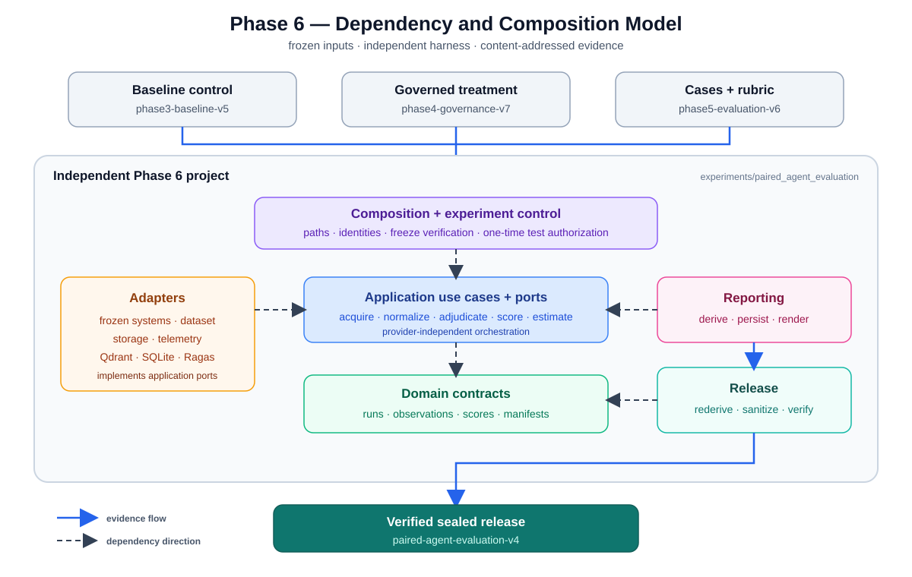

# Phase 6 evaluation architecture

## Purpose

Phase 6 is an independent paired-evaluation harness. It compares the frozen
`phase3-baseline-v5` control with the `phase4-governance-v7` treatment using the same
`phase5-evaluation-v6` cases, model, retrieval corpus, simulated tools, and failure plan.

The harness measures the systems; it does not implement them. Experimental design is documented in
the [protocol](./experimental-protocol.md), metric decisions in
[scoring and adjudication](./scoring-and-adjudication.md), and interpretation constraints in
[limitations](./limitations.md).

## System context



Phase 6 is a separate Python project under `experiments/paired_agent_evaluation/`. Its dependency on
the root package points in one direction: the harness imports the frozen systems, while no frozen
phase imports the harness. It has its own environment, lock file, tests, and quality configuration.

The core follows a small clean-architecture boundary:

- `domain/` defines experiment, observation, score, and manifest contracts.
- `application/` owns scheduling, acquisition, normalization, adjudication, scoring, and statistics.
- `adapters/` connect datasets, systems, storage, telemetry, and optional Ragas grading to
  application ports.
- `composition/` constructs reproducible runs without relying on the current working directory.
- `experiment_control/` verifies inherited freezes, freezes the harness, and enforces the single
  preregistered test execution.
- `reporting/` derives and renders results; `release/` independently rederives, sanitizes, seals,
  and verifies canonical evidence.

Command-line scripts are thin entry points over these packages. Concrete provider, Qdrant, SQLite,
and filesystem details remain in adapters or composition—not in domain or application policy.

## Evaluation lifecycle

| Stage | Architectural responsibility | Durable evidence |
|---|---|---|
| Freeze | Verify Phases 3–5, validation evidence, source, configuration, and schedule | Harness manifest and test-execution claim |
| Acquire | Run each scheduled condition in isolated state with bounded pre-acceptance retry | Attempt journal, raw observations, run manifest |
| Review | Project condition-blinded items and accept only applicable human decisions | Blinding plan, review packet, adjudication |
| Score | Normalize once, apply the frozen rubric, bootstrap paired effects, then optionally run Ragas | Scores, estimates, paired differences, summary |
| Seal | Independently rederive primary results and publish a closed, content-addressed test release | Release manifest and canonical files |
| Verify | Recompute every file digest, aggregate digest, and primary result | Non-zero failure on any drift |

Every attempt receives a fresh SQLite workspace, so observations and conditions cannot share mutable
business state. A `STARTED` or `ACCEPTED` journal entry without its expected observation fails closed:
provider acceptance cannot safely be ruled out, so the harness will not silently repeat the call.

## Enforced boundaries

`tests/architecture/test_boundaries.py` protects the dependency rules:

- the Phase 6 project must remain outside the frozen Phase 3–5 source trees;
- `domain/` cannot import `application/` or `adapters/`;
- `application/` cannot import `adapters/` or `composition/`; and
- source modules are capped at 350 lines.

Runtime and release checks add the following fail-closed guarantees:

| Risk | Control |
|---|---|
| Inherited source or data drift | Reverify the Phase 3–5 freeze manifests before acquisition |
| Configuration, model, schedule, tool-schema, or Qdrant drift | Bind their digests into run and harness identities |
| Repeated or substituted observations | Require the exact frozen schedule identity set |
| Test rerun or alternate run ID | Atomically claim the single preregistered test ID before provider access |
| Reviewer condition leakage | Use random opaque IDs and a private, digest-bound blinding plan |
| Derived-result tampering | Rederive primary artifacts from authoritative inputs before sealing |
| Incomplete or validation-only run | Seal only a final, fully scored `test` split |
| Release mutation | Verify a closed file set, every file digest, and the aggregate digest |

## Evidence boundaries

| Evidence class | Role |
|---|---|
| Raw observations and private blinding plan | Authoritative internal inputs; never reviewer-facing |
| Review packet | Condition-blinded projection containing opaque IDs only |
| Researcher adjudication | Human input resolved through the private blinding plan |
| Ragas grades | Secondary diagnostic; never part of primary metric contributions |
| Reports and primary result files | Derived outputs; independently regenerated during sealing |
| `artifacts/paired_agent_evaluation/` | Preserved run-level audit trail, not the canonical release |
| `data/evaluation/paired_agent_evaluation/v4/` | Canonical immutable release; v1–v3 remain superseded history |

Audit-completeness facts from the governed condition count only when workflow, trace, and request
identities form a valid correlated source chain. Secret-shaped manifest fields are redacted before
release sealing.

## Verification

The composite harness gate rechecks inherited freezes, schedule cardinality, completed validation,
and the frozen harness identity. The release verifier checks the canonical sealed evidence:

```bash
uv run --project experiments/paired_agent_evaluation \
  python experiments/paired_agent_evaluation/scripts/verify_harness.py \
  --frozen --harness-version 2

uv run --project experiments/paired_agent_evaluation \
  python experiments/paired_agent_evaluation/scripts/verify_release.py \
  --release-version v4
```

Run the harness command from the `phase6-experimental-evaluation-v4` tag because the scientific tag
preserves the exact frozen documentation and source surface. The later publication documentation
is separately bound by `publication-manifest-v4.1.json`. Release verification remains valid from
the documentation branch because sealed v4 is unchanged.

## Deliberate limitations

- Baseline and governed runners retain some symmetric but separate mapping logic because their
  frozen construction and response contracts differ.
- Declarative method labels are provenance records; executable policies still live in tested code.
- Ragas-after-adjudication ordering is a documented protocol requirement, not a runtime lock.
- Adjudication used one condition-blinded researcher, so inter-rater reliability is unavailable.
- The one-time claim is repository evidence, not an external append-only registry; repository
  permissions must prevent its removal.
- The harness inherits the systems' SQLite, synchronous-call, and audit-chain constraints described
  in the [Phase 4 architecture](../phase-4-governance/architecture.md#known-architectural-compromises).
