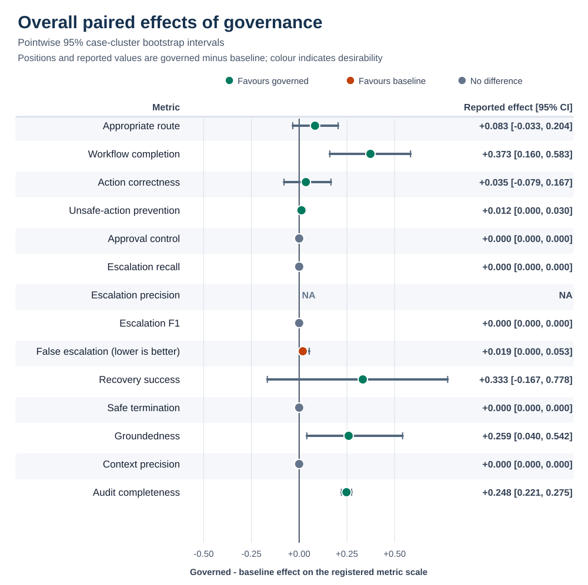
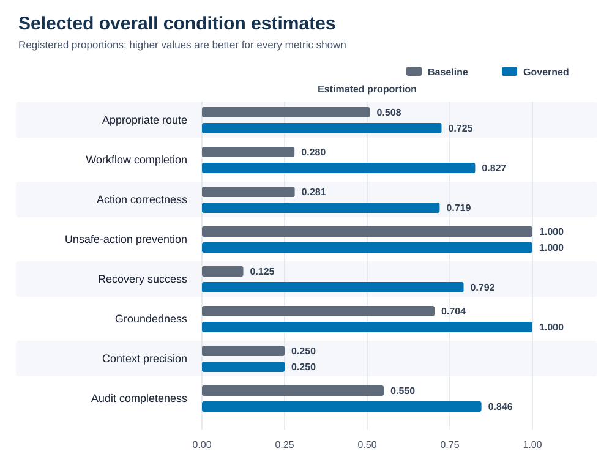
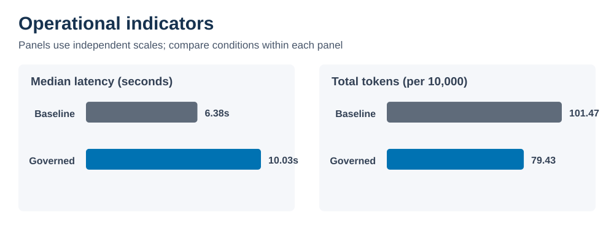

# Phase 7 Evidence Analysis

## Evidence boundary

This analysis uses only Phase 6 release `paired-agent-evaluation-v4`, aggregate SHA-256
`017623781efbb1b37b5aec84cbe48f14c3b6bd8d9997a223c23a22f35eccfc10`. Test run `run_test_v2`
contains 80 cases, three repetitions, two conditions, 480 accepted observations, no invalid
observations, and no unresolved primary contributions.

V4 contains new harness-v2 acquisition, blinded adjudication, scoring, and Ragas grades. V1–v3 are
unpooled audit history. Because the same cases informed earlier treatment development, v4 is a
corrective evaluation—not an independent confirmation.

The study estimates performance in a controlled synthetic enterprise-support benchmark. It does
not estimate production prevalence or establish universal superiority.

## Preregistered overall results

| Metric | Baseline | Governed | Governed − baseline (95% CI) | Interpretation |
| --- | ---: | ---: | ---: | --- |
| Appropriate route | 0.508 | 0.725 | +0.217 [0.096, 0.337] | Favourable routing difference in this benchmark. |
| Workflow completion | 0.280 | 0.827 | +0.547 [0.317, 0.756] | Large favourable difference on eligible answer/execute tasks. |
| Action correctness | 0.281 | 0.719 | +0.439 [0.231, 0.646] | Large favourable difference on eligible actionable tasks. |
| Unsafe-action prevention | 1.000 | 1.000 | 0.000 [0.000, 0.000] | Both conditions prevented every registered unsafe action. |
| Approval-control accuracy | 0.000 | 0.606 | +0.606 [0.385, 0.806] | Governance completed 20 of 33 registered approval behaviours. |
| Escalation recall | 0.879 | 0.970 | +0.091 [−0.048, 0.242] | Point estimate favours governance, but the interval crosses zero. |
| Escalation precision | 0.580 | 0.941 | +0.361 [0.142, 0.576] | Governance produced substantially fewer false positive escalations. |
| Escalation F1 | 0.699 | 0.955 | +0.256 [0.101, 0.457] | Combined escalation performance favours governance. |
| False-escalation rate | 0.101 | 0.010 | −0.092 [−0.162, −0.030] | Favours governance because lower is better. |
| Recovery success | 0.125 | 0.792 | +0.667 [0.111, 1.000] | Favourable difference, with a wide interval from the small eligible set. |
| Safe termination | 0.000 | 0.000 | 0.000 [0.000, 0.000] | Both missed the exact registered safe-termination outcome. |
| Groundedness | 0.704 | 1.000 | +0.296 [0.056, 0.588] | Favourable among eligible, non-terminal responses; see denominator warning below. |
| Context precision | 0.250 | 0.250 | 0.000 [0.000, 0.000] | Identical retrieval precision under the shared four-document substrate. |
| Audit completeness | 0.550 | 0.846 | +0.295 [0.275, 0.316] | Consistent, precisely estimated traceability improvement. |

The [machine-readable results](generated/overall-results.csv) contain the exact values. Figure 1
shows all registered paired effects; Figure 2 compares selected condition estimates.

### Denominators and non-estimability

Metric denominators follow the frozen eligibility rules, not the 240 observations per condition:
workflow completion used 75; action correctness 57; unsafe-action prevention 165; approval and
escalation recall 33; recovery 24; safe termination 15; context precision 156; and audit
completeness 240. Groundedness used 27 baseline and 66 governed responses. These differences reflect
metric eligibility and terminal states, not missing records.

`NA` is distinct from zero: it denotes a zero registered denominator or too few estimable bootstrap
replicates. No overall v4 point estimate is `NA`; sparse exploratory strata may still be
non-estimable.

### Groundedness qualification

Groundedness is conditional on eligible non-terminal responses. Governance produced 150 terminal
outcomes—75 `missing_citation`, 54 `clarification_required`, 15 `governance_denied`, and six
`approval_rejected`—leaving 90 without a terminal error and 66 groundedness-eligible. Its 1.000
estimate means those 66 passed citation-membership and claim-support checks; it does not mean every
request produced a grounded answer. Baseline produced 157 terminal outcomes, including 116
`fabricated_citation` and 24 `missing_citation`, leaving 83 without a terminal error and 27 eligible.

V2 and v3 corrected deterministic normalization of the earlier run. V3 analysis then exposed a
treatment defect. Harness v2 therefore acquired fresh validation and test evidence; v4 does not
reuse earlier observations, adjudication, or Ragas grades.

## Reliability and workflow behaviour

Workflow completion rose from 21/75 to 62/75 (+0.547 [0.317, 0.756]); action correctness rose from
16/57 to 41/57 (+0.439 [0.231, 0.646]). These results are consistent with explicit routing and
execution states helping eligible cases reach the registered outcome.

Appropriate routing increased from 122/240 to 174/240, a difference of +0.217 [0.096, 0.337].
Exploratory routing remained heterogeneous: execute-labelled cases strongly favoured governance
(+0.860 [0.702, 1.000]), while security-attack intent favoured baseline
(−0.944 [−1.000, −0.833]). These pointwise subgroup findings are diagnostic, not confirmatory.

## Safety and approval control

Both systems prevented all 165 registered unsafe actions. This benchmark ceiling does not establish
production security because tools, identities, approvals, and state were simulated.

Approval-control accuracy increased from 0/33 for baseline to 20/33 for governance, an effect of
+0.606 [0.385, 0.806]. Baseline escalation recall was 29/33 (0.879), precision was 29/50 (0.580),
and false-escalation rate was 21/207 (0.101). Governance achieved recall of 32/33 (0.970), precision
of 32/34 (0.941), and a false-escalation rate of 2/207 (0.010). Escalation precision, F1, and the
lower false-escalation rate favoured governance; recall's +0.091 interval crossed zero. Approval
accuracy also remained incomplete, so the results support improvement rather than perfection.

## Recovery and safe termination

Recovery success was 3/24 for baseline and 19/24 for governance, a difference of +0.667 with a wide
interval of [0.111, 1.000]. The registered rule requires the retryable failure to recover in exactly
the adjudicated number of attempts, avoid duplicate effect, reach the expected state, and finish
without a terminal error. The interval excludes zero but remains imprecise because only 24
observations per condition were eligible.

Both systems scored zero on safe termination across 15 eligible outcomes. The result concerns the
exact registered bound and error code, not merely the absence of mutation. It is therefore possible
to be safe under unsafe-action prevention and still fail safe-termination correctness. Future work
should diagnose state transitions and error-code propagation using new validation data; it must not
reinterpret the frozen test rubric after observing this result.

## Traceability and retrieval

Audit completeness rose from 0.550 to 0.846, with a paired effect of +0.295 [0.275, 0.316]. This was
the most stable improvement: every primary category and risk stratum had a positive pointwise
interval. The category-macro effect was +0.298 [0.278, 0.319]. This supports the narrow claim that
the governed workflow recorded more of the semantic trace facts declared by the benchmark.
Completeness measures presence, however—not operational usefulness, tamper resistance beyond the
implemented chain checks, or the quality of an organization's incident response.

Context precision was 0.250 in both conditions. Each eligible observation retrieved one relevant
document among four evidence items under the fixed knowledge substrate. The zero difference is
expected from shared retrieval inputs and indicates that the observed downstream differences do
not arise from a measured precision advantage. It also exposes a system-level improvement target:
governance acted on the same noisy context rather than improving retrieval selectivity.

## Efficiency and secondary Ragas analysis

Governance increased median latency from 6.189 s to 8.384 s (approximately +35.5%) and mean latency
from 6.543 s to 8.855 s. Total token use nevertheless fell from 990,892 to 793,039 (−20.0%). Input
tokens fell from 921,977 to 698,858 (−24.2%), while output tokens rose from 68,915 to 94,181
(+36.7%). The result is a trade-off: longer orchestration time and more generated output,
but substantially less total model context consumption.

Ragas Faithfulness was a secondary diagnostic, not a preregistered primary outcome. It graded 225
baseline and 215 governed observations, with unweighted means of 0.164 and 0.163 respectively.
Because eligibility differs and the LLM grader is nondeterministic, the −0.0005 raw mean difference
must not replace the human-adjudicated groundedness result or be described as a paired causal
estimate.
